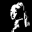
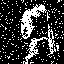

# Hopfield Neural Network

- [Problem description](#problem-description)
- [1. Pattern acquisition](#1-pattern-acquisition)
- [2. Learning phase](#2-learning-phase)
- [3. Recall phase](#3-recall-phase)
- [Simplified example](#simplified-example)
- [Model limitations](#model-limitations)
- [Possible model extensions](#possible-model-extensions)
- [Useful references](#useful-references)

---

## Problem description

A **Hopfield neural network** is a type of recurrent neural network introduced by John J. Hopfield in 1982. It works as an **associative memory**: the network learns to recognize certain patterns and, when shown a partial or noisy pattern, is able to reconstruct the original complete one.

Imagine trying to recall a song after hearing just a few notes: the brain automatically reconstructs the rest. Hopfield networks work in an analogous way.

From a physical standpoint, the system is made up of $N$ neurons, each of which can be in one of two states: on ($+1$) or off ($-1$). The neurons are all connected to each other via symmetric connections (if $A$ is connected to $B$, then $B$ is connected to $A$ with the same strength). The network evolves over time following an **update rule** that drives the system to minimize an energy function, in a way entirely analogous to a physical system settling into its state of minimum energy.

Original reference: [Hopfield, "Neural networks and physical systems with emergent collective computational abilities" (1982)](https://www.pnas.org/doi/10.1073/pnas.79.8.2554)

The project is organized into three main phases:

1. **Pattern acquisition** — reading images and converting them into binary ±1 vectors.
2. **Learning** — computing the weight matrix $W$ that encodes the patterns into the network's memory.
3. **Recall** — starting from a corrupted or incomplete pattern and letting the network evolve until convergence.

---

## 1. Pattern acquisition

Before training the network, the data must be prepared. Each input image is converted into a vector of ±1 values, which is the format the network can process.

### Loading the image

Images are loaded pixel by pixel, for example using the SFML graphics library. Each pixel is described by three values: the red ($R$), green ($G$), and blue ($B$) color components, each ranging from 0 to 255.

### Standardizing dimensions

The network requires all patterns to have the same length $N$ (total number of pixels). If the source images have different sizes, they must be resized before conversion. Two possible strategies:

- **Simple method**: regularly remove rows and columns, for example discarding every $k$-th row and column until the desired size is reached.
- **More accurate method (bilinear interpolation)**: the value of each pixel in the new image is computed as a weighted average of neighboring pixels in the original image. This produces visually better results but is more complex to implement.

### Binarization

For each pixel, the average of the three color components is computed:

```math
\text{gray} = \frac{R + G + B}{3}
```

If the value exceeds a threshold (typically 127), the pixel becomes $+1$ (light); otherwise it becomes $-1$ (dark). The image is then "unrolled" into a one-dimensional vector by reading the pixels row by row, obtaining the pattern $\xi^\mu$.

The index $\mu$ identifies the pattern (from 1 to the total number $P$ of images), the index $i$ identifies the neuron (from 1 to $N$). The value of neuron $i$ in pattern $\mu$ is denoted $\xi_i^\mu$.

### Visualization

It is useful to visualize both the original image and the binarized one to verify that the conversion is correct.

<div style="text-align: center;">
  
  
</div>

---

## 2. Learning phase

The goal of this phase is to build the weight matrix $W$, which represents the network's "memory". Each element $W_{ij}$ describes how strong the connection is between neuron $i$ and neuron $j$.

### Hebb's rule

The rule used to build $W$ is called **Hebb's rule**, inspired by the biological idea that "neurons that fire together wire together". In practice, if two neurons tend to have the same value across many stored patterns, their connection will be strong and positive; if they tend to have opposite values, it will be strong and negative.

The explicit formula is:

```math
W_{ij} =
\begin{cases}
\dfrac{1}{N} \displaystyle\sum_{\mu=1}^{P} \xi_i^\mu\, \xi_j^\mu & \text{if } i \neq j \\[10pt]
0 & \text{if } i = j
\end{cases}
```

The diagonal is set to zero to prevent a neuron from influencing itself. The division by $N$ is a normalization that keeps the weights within a reasonable range regardless of pattern size.

### Matrix properties

The matrix $W$ is **symmetric**: $W_{ij} = W_{ji}$ for every pair of neurons. This is fundamental because it guarantees that the energy function (introduced in the recall phase) can never increase during the network's evolution.

### Saving

After computation, the matrix $W$ is saved to a file. This avoids repeating the learning phase every time: it will be enough to load the already-computed matrix to start recall.

---

## 3. Recall phase

The network is now trained. In this phase, it is presented with a corrupted or incomplete pattern, and we let it evolve spontaneously toward one of the stored patterns.

### Preparing the corrupted pattern

One starts from one of the stored patterns and corrupts it in one of these ways:

- **Random noise**: some pixels are randomly flipped (some $+1$ become $-1$ and vice versa), simulating a distorted image.
- **Cropping**: a portion of the image is systematically inverted (for example, the lower half), simulating a partial image.

<div style="text-align: center;">
  
</div>

### Update dynamics

The network updates the neurons' states one at a time (asynchronous update) following this rule:

```math
s_i(t+1) = \text{sign}\!\left(\sum_{j=1}^{N} W_{ij}\, s_j(t)\right)
```

where $s_i(t)$ is the state of neuron $i$ at time $t$. In simple terms: each neuron looks at the "weighted sum" of the states of all other neurons. If this sum is positive, the neuron moves to $+1$; if it is negative, it moves to $-1$.

This process is repeated iteratively until convergence.

### Convergence criterion

The network has reached a stable state when a full iteration produces no change:

```math
s_i(t+1) = s_i(t) \quad \forall\, i
```

At that point the network has settled into a minimum of the energy function, which ideally corresponds to one of the stored patterns.

### Energy function

To monitor the process, the **energy function** is introduced:

```math
E(t) = -\frac{1}{2} \sum_{i,j} W_{ij}\, s_i(t)\, s_j(t)
```

This quantity is not a physical energy in the thermodynamic sense, but it is a very useful mathematical analogy: it can be shown that, thanks to the symmetry of $W$, the function $E$ **can never increase** during the network's evolution under asynchronous updates. Each update drives the system toward a local minimum, and the process terminates once a minimum is reached.

Monitoring $E(t)$ at each iteration makes it possible to verify that convergence is occurring correctly: the plot must always be decreasing or constant.

---

## Simplified example

Consider a network with only 4 neurons ($N = 4$) and two stored patterns ($P = 2$):

```math
\xi^{(1)} = (-1,\; 1,\; 1,\; -1)
\qquad
\xi^{(2)} = (1,\; -1,\; -1,\; 1)
```

Note that $\xi^{(2)} = -\xi^{(1)}$: the two patterns are opposite.

### Step 1: computing the weight matrix

Hebb's rule is applied. The matrix is $4 \times 4$ with zero diagonal. For each pair $(i,j)$ with $i \neq j$:

```math
W_{ij} = \frac{1}{4}\left(\xi_i^{(1)}\xi_j^{(1)} + \xi_i^{(2)}\xi_j^{(2)}\right)
```

| Pair | Contribution pattern 1 | Contribution pattern 2 | $W_{ij}$ |
|--------|----------------------|----------------------|----------|
| $W_{12}$ | $(-1)(1) = -1$ | $(1)(-1) = -1$ | $-1/2$ |
| $W_{13}$ | $(-1)(1) = -1$ | $(1)(-1) = -1$ | $-1/2$ |
| $W_{14}$ | $(-1)(-1) = 1$ | $(1)(1) = 1$   | $+1/2$ |
| $W_{23}$ | $(1)(1) = 1$   | $(-1)(-1) = 1$ | $+1/2$ |
| $W_{24}$ | $(1)(-1) = -1$ | $(-1)(1) = -1$ | $-1/2$ |
| $W_{34}$ | $(1)(-1) = -1$ | $(-1)(1) = -1$ | $-1/2$ |

The elements not listed are obtained by symmetry ($W_{ji} = W_{ij}$).

### Step 2: recall from a corrupted pattern

Suppose we present the network with this corrupted pattern (the first bit is wrong relative to $\xi^{(1)}$):

```math
s_{\text{initial}} = (1,\; -1,\; 1,\; -1)
```

The neurons are updated one at a time:

**Neuron 1:**
```math
h_1 = W_{12}s_2 + W_{13}s_3 + W_{14}s_4
    = (-\tfrac{1}{2})(-1) + (-\tfrac{1}{2})(1) + (\tfrac{1}{2})(-1)
    = \tfrac{1}{2} - \tfrac{1}{2} - \tfrac{1}{2} = -\tfrac{1}{2}
```
$s_1' = \text{sign}(-\tfrac{1}{2}) = -1$ ✓

**Neuron 2:**
```math
h_2 = W_{21}s_1' + W_{23}s_3 + W_{24}s_4
    = (-\tfrac{1}{2})(-1) + (\tfrac{1}{2})(1) + (-\tfrac{1}{2})(-1)
    = \tfrac{3}{2}
```
$s_2' = \text{sign}(\tfrac{3}{2}) = +1$ ✓

**Neuron 3** and **Neuron 4** update in an analogous way and remain $+1$ and $-1$ respectively.

The final pattern is:

```math
s' = (-1,\; 1,\; 1,\; -1) = \xi^{(1)}
```

The network corrected the erroneous bit and recovered the stored pattern.

---

## Model limitations

- **Limited capacity**: the maximum number of patterns the network can store without errors is approximately $0.138 \times N$. For a network with 1000 neurons, at most about 138 patterns can be reliably stored.

- **Spurious patterns**: stable states that do not correspond to any stored pattern can appear. These are called *spurious attractors* and represent the model's main flaw. The main types are *mixtures*, stable states corresponding to the average of an odd number of patterns, and *spin-glass* states, chaotic configurations unrelated to the stored patterns.

- **Patterns that are too similar**: if two stored patterns closely resemble each other, the network may confuse them during recall.

- **Binary values only**: the standard model works exclusively with $\pm 1$ states.

---

## Possible model extensions

### Discouraging spurious patterns (nonlinear field)

The update field of the standard rule can be rewritten without using the matrix $W$, by directly computing the **overlaps** between the current state and each stored pattern:

```math
m^\mu(t) = \frac{1}{N} \sum_{j=1}^{N} \xi_j^\mu\, s_j(t)
```

The overlap $m^\mu$ measures how much the current state $s(t)$ resembles the pattern $\xi^\mu$: it equals $+1$ if they coincide perfectly, $-1$ if they are opposite, $0$ if they are orthogonal. With this notation, the standard update rule becomes equivalent to:

```math
s_i(t+1) = \text{sign}\!\left(\sum_{\mu=1}^{P} m^\mu(t)\; \xi_i^\mu\right)
```

The problem is that spurious patterns (mixed states with two similar overlaps, $m^1 \approx m^2$) are stable fixed points of this equation. The simplest solution is to **replace** $m^\mu$ with a superlinear function $f(m^\mu)$:

```math
s_i(t+1) = \text{sign}\!\left(\sum_{\mu=1}^{P} f(m^\mu)\; \xi_i^\mu\right)
```

The most elementary choice is $f(m) = m^3$. Intuitively: if $m^1 = 0.6$ and $m^2 = 0.6$ (mixed state), after cubing we get $f(m^1) = f(m^2) = 0.216$ and the state remains unstable, while any small perturbation that moves the network closer to one of the two patterns gets amplified, leading to convergence toward the pure pattern. For a pure pattern, on the other hand ($m^1 \approx 1$, all others $\approx 0$), the nonlinearity does not change the result: $f(1) = 1$.

This approach brings two practical advantages: it eliminates the need to allocate and store the matrix $`W`$ (which takes up $`O(N^2)`$ memory), reducing the update from $`O(N^2)`$ to $`O(NP)`$ operations per iteration; and it suppresses spurious attractors without altering the ones corresponding to the stored patterns.

Using instead $`f(m) = \exp(\beta\, m)`$ with large $`\beta`$ yields the formulation of *Modern Hopfield Networks* (Ramsauer et al., 2020), which achieves memory capacity exponential in $`N`$.

### Metropolis-Hastings algorithm

Instead of updating each neuron deterministically, a **stochastic dynamics** is introduced: neuron $`i`$ changes state with a probability that depends on the energy change $`\Delta E`$ that the flip would produce:

```math
P(\text{flip}) = \frac{1}{1 + e^{\,\Delta E / T}}
```

where $`T`$ is a parameter playing the role of temperature. If $`\Delta E \lt 0`$ (the flip lowers the energy), the change is almost always accepted. If $`\Delta E \gt 0`$ (the flip raises the energy), it is accepted only with a small probability. This mechanism allows the network to **escape spurious local minima**, at the cost of slower convergence.

### Simulated annealing

The Metropolis approach is extended by introducing a temperature $`T`$ that **decreases gradually** over time, following a so-called *cooling schedule*. Initially, with $`T`$ high, the network freely explores the state space; as $`T`$ decreases, the system progressively settles toward states of ever-lower energy. The physical analogy is metal annealing: by heating and then slowly cooling a material, the atoms find the crystalline configuration of minimum energy.

---

## Useful references

- [Hopfield, "Neural networks and physical systems with emergent collective computational abilities" (1982)](https://www.pnas.org/doi/10.1073/pnas.79.8.2554) — the original paper.
- [Hopfield Networks is All You Need](https://ml-jku.github.io/hopfield-layers/) — a modern overview of Hopfield networks, with deep learning extensions and connections to Modern Hopfield Networks.
- [Wikipedia — Metropolis-Hastings algorithm](https://en.wikipedia.org/wiki/Metropolis%E2%80%93Hastings_algorithm)
- [Wikipedia — Simulated Annealing](https://en.wikipedia.org/wiki/Simulated_annealing)
